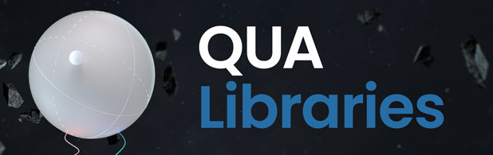

[](https://discord.gg/7FfhhpswbP)
[](./LICENSE)

<!-- Netlify (docs deploy) and Zenodo (citable DOI) badges are placeholders;
     fill in the IDs once this repo has its own Netlify site and Zenodo record. -->
[](https://app.netlify.com/sites/qua-libs-core/deploys)
[](https://zenodo.org/badge/latestdoi/REPLACE_WITH_ZENODO_ID)

# QUA Libraries

Hey! Glad to see you there!

Welcome to the QUA libraries. Your one-stop-shop for a batteries-included QUA experience.

This repo is where we share the general-purpose tutorials and tools that aren't tied to any particular qubit platform, and it points you to the platform-specific libraries below.

It includes:
* The ["Tutorials"](./Tutorials) folder contains various tutorials and guides for working with the OPX — timing, streams, demodulation, simulation, macros, Octave, and more.

## Installing

Install `qua-libs-core` from PyPI:

```bash
pip install qua-libs-core
```
That gives you the importable `qua_libs_core` package, including `qua_libs_core.telemetry` used across the qua-libs repositories, without the QUA SDK.

Or clone this repository for tutorials and the installer in addition to telemetry:

```bash
git clone https://github.com/qua-platform/qua-libs-core
cd qua-libs-core
uv sync --extra tutorials
```

Documentation for telemetry is seen in
[`qua_libs_core.telemetry`](docs/telemetry/README.md).

### QUA Libraries installer

For a batteries-included modality setup (clone, virtualenv, QUAlibrate, optional
local Uptrace), use [`tools/installer/`](tools/installer/README.md).
See [telemetry installer docs](docs/telemetry/INSTALLER.md) for Docker and config
file behavior.

## QUA libraries by platform

Examples, use cases, and calibration protocols for specific qubit platforms live in their own repositories:

| Repository | Platform |
|---|---|
| [qua-libs-superconducting](https://github.com/qua-platform/qua-libs-superconducting) | Superconducting transmons |
| [qua-libs-nv](https://github.com/qua-platform/qua-libs-nv) | NV / optically addressable spin qubits |
| [qua-libs-quantum-dots](https://github.com/qua-platform/qua-libs-quantum-dots) | Quantum dots |
| [qua-libs-neutral-atoms](https://github.com/qua-platform/qua-libs-neutral-atoms) | Neutral atoms (Rydberg, cavity locking) |
| [qua-libs-trapped-ion](https://github.com/qua-platform/qua-libs-trapped-ion) | Trapped ions |

## Support and Contribution
This is a beta version of the repo, and thus, if you see quirks and inaccuracies please tell us!
Love to see some example that's not yet included? tell us! Have a request for a general purpose procedure? tell us!
Already have something cool that others could use? Open a pull request! You can follow [this guide](./CONTRIBUTING.md) and feel free to contact us if you need any help.
Issue reporting and requests should be done via the [GitHub issues system](https://github.com/qua-platform/qua-libs-core/issues), that should give a transparent experience where all users can see what's coming and which issues are already known.
We hope this repo becomes a useful resource, giving real contribution to the community, and we'd love to see your ideas and contributions too!
